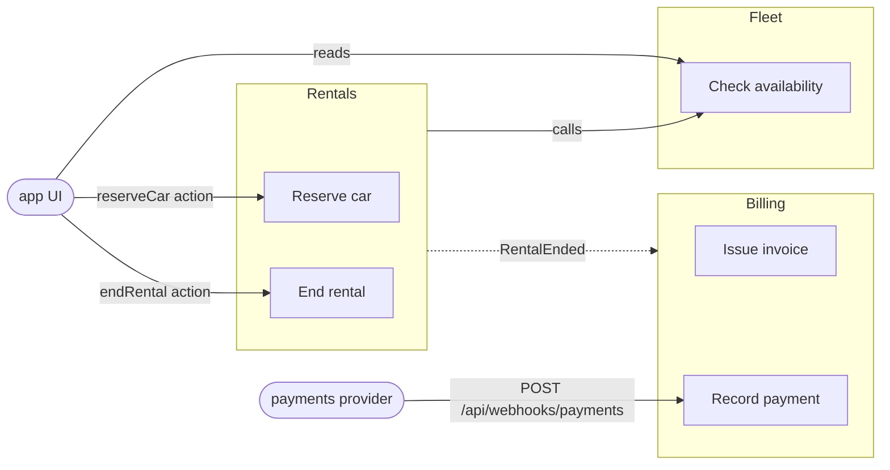

# Context map

How the bounded contexts fit together: what each exposes, what reaches it, and which events flow between them. Each context's own document (`docs/domain/<context>.md`) has the detail; this is the one picture of the whole system.

<!-- Replace the example below with the real contexts. Conventions:
- One `subgraph` per bounded context, named as in docs/domain/. Inside it, one node per published use case or query.
- The app's UI (`ui`) reaches a use case through a Server Action: solid arrow labelled with the action's name. A Server Component reading a query: solid arrow labelled `reads`.
- A caller outside the app (a webhook, a partner) reaches a use case through a Route Handler: a plain node for the caller, solid arrow labelled with the method and path.
- One context calls another through its index.ts: solid arrow from the calling context to the use case, labelled `calls`.
- A context publishes a domain event (past tense): dashed arrow from the publishing context to each consumer, labelled with the event name.
- Generic subdomains or external services (payments provider, email) are plain nodes outside any subgraph. -->

Legend: solid arrow, a call (a Server Action or read from the UI, a Route Handler from outside, or one context calling another through its `index.ts`); dashed arrow, a domain event from publisher to consumer.
